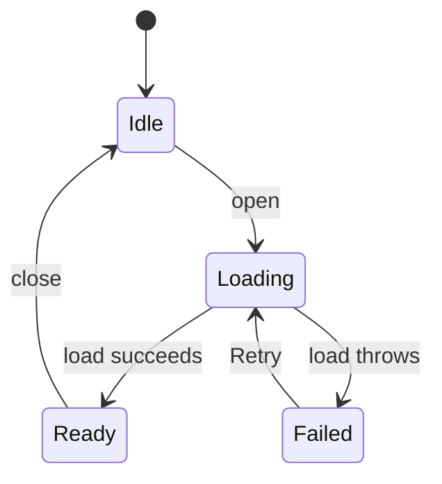

# State machines doc template

Keep an existing doc's place, headings and style. For a new one, put it with the repo's developer docs (`docs/developer/state-machines.md`, `docs/state-machines.md`, or the wiki source folder if the wiki is published from the repo) and start from this.

Rules for the doc:

- It describes how the code behaves now. Known bugs go in issues; the doc keeps a one-line failure note that links the issue.
- Name code by file and symbol, as code text, not links or line numbers, so moves don't break it. If the repo's existing doc pins references to a commit, keep that convention.
- Every state on a diagram or table appears in the prose or the table, and every failure state says how it recovers, or that it doesn't.
- Mermaid `stateDiagram-v2` renders on GitHub. Use a diagram for machines with loops or several exits, a State | Event | Next table when events need explaining, or both.
- Write for a contributor who knows the language but not this code.

````markdown
# State machines

<One paragraph: what parts of <project> keep state that no type names, and that this page lists each one, its states and transitions, and the failure states it can reach. Update it in the same change as any change to these states, their triggers or their exits; see the State machines section of AGENTS.md.>

## How to read this page

An _implicit_ state machine is state spread over fields, flags, optional values, caches, tasks or files, plus the code that changes them. No type lists its states, so this page does.

A box in a diagram is a state and an arrow is a transition labelled with the event that causes it. `[*]` is where the machine starts or ends.

<Lifetimes, if they differ between machines: which state lasts one call, one instance or reload, the whole process, or survives on disk, and what is shared between windows, clients or processes, including processes that run with different settings against the same files.>

<If the code guards against stale messages or callbacks, list each guard here: what it is, who issues it, and what it drops.>

## <Area, if the repo has several>

### <Machine name>

<Owner: `path/to/file` and `Symbol`. One or two sentences: what it tracks and its lifetime (per process, per window, per request, per reload).>



| State | Event | Next |
| --- | --- | --- |
| Idle | `open` | Loading. |
| Loading | The load throws | Failed, with the error shown. |
| Failed | Retry | Loading. |

Failure states:

- <A confirmed failure state and how it's reached, in one or two lines.> Tracked in [#N](<issue URL>). <Before the issue is filed, end the line with exactly: Not tracked yet.>

## No lasting state

<Helpers that decide a machine's outcome but keep nothing between calls, one line each: what outcomes they return.>
````
